# 📹 Awesome Web Conferencing & Virtual Classroom 🎓

<div align="center">

<p align="center">
  
</p>

# 🌐 Top Web Conferencing & Virtual Classroom Ecosystem

**A Curated Directory of SaaS Solutions, Open-Source Video Platforms, WebRTC Media Servers, and Self-Hosted Virtual Classrooms**

<p align="center">
  <a href="https://github.com/ishandutta2007/Awesome-Awesome-Awesome"></a>
  <a href="https://discord.gg/jc4xtF58Ve"></a>
  <a href="https://github.com/ishandutta2007/Awesome-Web-Conferencing-Virtual-Classroom/stargazers"></a>
  <a href="https://github.com/ishandutta2007/Awesome-Web-Conferencing-Virtual-Classroom/network/members"></a>
  <a href="https://github.com/ishandutta2007/Awesome-Web-Conferencing-Virtual-Classroom/pulls"></a>
  <a href="https://opensource.org/licenses/MIT"></a>
  <a href="https://github.com/ishandutta2007"></a>
</p>

</div>

---

## 📖 Overview & SEO Summary

Welcome to the definitive, SEO-optimized knowledge base and curated list of **Web Conferencing Platforms**, **Virtual Classroom Software**, and **WebRTC Media Engines**. Whether you are an educator evaluating interactive pedagogical tools, a DevOps architect deploying self-hosted SFU/MCU servers for data sovereignty, or an enterprise IT manager provisioning unified communications, this guide provides complete, up-to-date architectural trade-offs, pricing transparency, and developer metrics.

### 🔍 Key Focus Areas & Keywords
- **Real-Time Video Collaboration**: WebRTC, Selective Forwarding Units (SFU), Multipoint Control Units (MCU), TURN/STUN NAT traversal.
- **Pedagogical Virtual Classrooms**: Multi-user interactive whiteboards, timed breakout rooms, student polling, LMS integrations (Moodle, Canvas, Blackboard via LTI 1.3).
- **Deployment Modalities**: Multi-tenant enterprise SaaS vs. Docker / Kubernetes self-hosted on-premises installations.
- **Data Sovereignty & Privacy**: GDPR, FERPA, HIPAA-compliant communications with end-to-end encryption (E2EE via Insertable Streams).

---

## 📑 Table of Contents

- [📊 Sector Overview & Market Dynamics](#-sector-overview--market-dynamics)
- [🏢 SaaS & Hosted Commercial Platforms](#-saas--hosted-commercial-platforms)
- [💻 Open-Source GitHub Projects & Media Engines](#-open-source-github-projects--media-engines)
  - [1. Jitsi Meet](#1-jitsi-meet-)
  - [2. LiveKit](#2-livekit-)
  - [3. Pion WebRTC](#3-pion-webrtc-)
  - [4. Owncast](#4-owncast-)
  - [5. BigBlueButton](#5-bigbluebutton-)
  - [6. Janus Gateway](#6-janus-gateway-)
  - [7. mediasoup](#7-mediasoup-)
  - [8. MiroTalk P2P](#8-mirotalk-p2p-)
  - [9. Ant Media Server](#9-ant-media-server-)
  - [10. MiroTalk SFU](#10-mirotalk-sfu-)
  - [11. OpenVidu](#11-openvidu-)
  - [12. Galène](#12-galène-)
  - [13. EduMeet](#13-edumeet-)
  - [14. Apache OpenMeetings](#14-apache-openmeetings-)
  - [15. plugNmeet](#15-plugnmeet-)
- [🏗️ Architectural Architecture Matrix: SFU vs MCU vs P2P](#️-architectural-architecture-matrix-sfu-vs-mcu-vs-p2p)
- [🤝 How to Contribute](#-how-to-contribute)
- [⭐ Star History](#-star-history)
- [💖 Support & Sponsorship](#-support--sponsorship)
- [⚖️ Disclaimer & License](#️-disclaimer--license)

---

## 📊 Sector Overview & Market Dynamics

The global web conferencing and virtual classroom market was estimated at **USD 15.8 Billion in 2023** and is projected to expand to **USD 38.5 Billion by 2030**, growing at a Compound Annual Growth Rate (CAGR) of **13.5%**.

In terms of market structure, the industry exhibits a **bifurcated landscape**:
- **Enterprise Web Conferencing** is **highly concentrated** (an oligopolistic, winner-take-most dynamic commanded by hyper-scalers Microsoft Teams, Google Meet, Zoom, and Cisco Webex).
- **Virtual Classrooms & Academic Video Infrastructure** remains **moderately fragmented**, fueled by strict student data privacy regulations (FERPA, GDPR), deep Learning Management System (LMS) customization requirements, and rapid adoption of open-source WebRTC engines (BigBlueButton, Jitsi Meet, and LiveKit) by academic institutions and sovereign entities.

---

## 🏢 SaaS & Hosted Commercial Platforms

The following table highlights top commercial conferencing and virtual classroom platforms, sorted in **descending order by company size (Valuation / Market Capitalization)**:

| 🏢 Product | 🏢 Company & Ticker | 📈 Valuation / Market Cap | 💵 Starting Tier Pricing | 🎁 Free Tier Limits & Free Trials | 🌟 Primary Strengths & Classroom Features |
| :--- | :--- | :--- | :--- | :--- | :--- |
| **Microsoft Teams** | Microsoft Corporation (NASDAQ: `MSFT`) | **~$3,100 Billion** ($3.1T Market Cap) | **$4.00 / user / month** (*Microsoft Teams Essentials*, annual commitment) | **Free Forever**: 100 participants, 60-min group meeting duration, 5 GB cloud storage per user, unlimited 1:1 chat | Deep enterprise Office 365 / Microsoft Graph integration, live captions, background blur, enterprise Active Directory security. |
| **Google Meet** | Alphabet Inc. (NASDAQ: `GOOGL`) | **~$2,100 Billion** ($2.1T Market Cap) | **$6.00 / user / month** (*Google Workspace Starter*, annual billing) | **Free Forever**: 100 participants, 60-min group meeting limit (up to 24 hrs for 1:1 calls), 15 GB shared Google Drive storage | Frictionless zero-install web browser client, seamless Google Calendar/Docs integration, native noise cancellation. |
| **Cisco Webex** | Cisco Systems, Inc. (NASDAQ: `CSCO`) | **~$220 Billion** ($220B Market Cap) | **$12.00 / license / month** (*Webex Meet Plan*, billed annually at $144/yr) | **Free Forever**: 100 participants, 40-min meeting limit, local meeting recording, interactive Slido polls, chat, breakout rooms | Enterprise-grade encryption, Cisco Room Kit hardware pairing, robust administrative compliance & telephony. |
| **Adobe Connect** | Adobe Inc. (NASDAQ: `ADBE`) | **~$215 Billion** ($215B Market Cap) | **$16.00 / host / month** (*Adobe Connect Standard*, billed annually at $190/yr) | **30-Day Free Trial**: Up to 25 participants, full classroom interactive pods, persistent custom room designs, recordings | Persistent modular digital pods, deep customizable pedagogical layouts, synchronized document sharing, educator analytics. |
| **Zoom Workplace** | Zoom Video Comm. (NASDAQ: `ZM`) | **~$20 Billion** ($20B Market Cap) | **$13.32 / user / month** (*Zoom Pro*, billed annually at $159.90/yr) | **Free Forever**: 100 participants, 40-min limit per group call, 3 editable whiteboards, local MP4 recording, automated captions | Industry-standard reliability, comprehensive third-party app marketplace, breakout rooms with timers, high-adoption UX. |
| **Zoho Meeting** | Zoho Corporation (Privately held) | **~$10 Billion+** Valuation ($1.2B ARR) | **$1.00 / host / month** (*Standard 10-attendee plan*, billed annually at $12/yr) | **Free Forever**: 100 participants, 60-min meeting limit, 2 simultaneous video feeds, screen sharing, VoIP audio | Budget-friendly pricing, native integration with Zoho CRM / Zoho Books, lightweight WebRTC browser interface. |
| **RingCentral Video** | RingCentral, Inc. (NYSE: `RNG`) | **~$3.0 Billion** ($3.0B Market Cap) | **$20.00 / user / month** (*RingCentral Core*, billed annually at $240/yr) | **Free Forever**: 100 participants (*RingCentral Video Pro*), 50-min group meeting limit, 10 hours cloud recording stored 7 days | Unified Communications as a Service (UCaaS), carrier-grade PBX integration, team messaging, automated AI transcriptions. |
| **GoTo Meeting** | GoTo / Francisco Partners (Private) | **~$2.5 Billion** Valuation (~$1.3B ARR) | **$12.00 / organizer / month** (*Professional plan*, billed annually at $144/yr) | **14-Day Free Trial**: Up to 250 participants, unlimited meeting length during trial, HD video, VoIP audio; no permanent free plan | Reliable enterprise screen sharing, dedicated GoTo Training modules for corporate learning with exams and certificates. |

---

## 💻 Open-Source GitHub Projects & Media Engines

Below are top open-source virtual classroom platforms, video conferencing suites, and WebRTC streaming servers, sorted in **descending order by GitHub star count**. Each repository badge links directly to its live stargazers page.

---

### 1. [Jitsi Meet](https://github.com/jitsi/jitsi-meet) [](https://github.com/jitsi/jitsi-meet/stargazers)
- 📝 **License**: Apache-2.0
- 🛠️ **Tech Stack**: JavaScript / React / Java / Prosody XMPP / Jitsi Videobridge (JVB)
- 💡 **Key Features**: The world’s most recognized open-source WebRTC video conferencing standard. Features zero-login guest join, low-latency Selective Forwarding Unit (SFU) architecture, screen sharing, etherpad integration, lobby waiting rooms, and Insertable Streams End-to-End Encryption (E2EE).
- 🚀 **Deployment**: Official Docker Compose stack with 4 microservice containers (web, prosody, jicofo, jvb); runs on 4 GB RAM minimum.

---

### 2. [LiveKit](https://github.com/livekit/livekit) [](https://github.com/livekit/livekit/stargazers)
- 📝 **License**: Apache-2.0
- 🛠️ **Tech Stack**: Go / WebRTC / TypeScript / Rust
- 💡 **Key Features**: Next-generation, developer-first real-time video, audio, and multimodal AI infrastructure. Delivers ultra-scalable distributed SFU clustering, client SDKs for React, iOS, Android, Flutter, Unity, and Python, alongside real-time voice AI pipelines.
- 🚀 **Deployment**: Single Go binary or Helm chart for Kubernetes clusters handling hundreds of thousands of concurrent streams.

---

### 3. [Pion WebRTC](https://github.com/pion/webrtc) [](https://github.com/pion/webrtc/stargazers)
- 📝 **License**: MIT
- 🛠️ **Tech Stack**: Go (Pure Go implementation of WebRTC API)
- 💡 **Key Features**: Pure Go WebRTC stack without C/C++ dependencies. The underlying building block for modern conferencing servers, Galène, plugNmeet, and distributed low-latency video networks.
- 🚀 **Deployment**: Go library embedded directly into custom media pipelines and IoT video appliances.

---

### 4. [Owncast](https://github.com/owncast/owncast) [](https://github.com/owncast/owncast/stargazers)
- 📝 **License**: MIT
- 🛠️ **Tech Stack**: Go / React / HLS / RTMP
- 💡 **Key Features**: Independent, self-hosted live video broadcast and interactive chat server. Ideal for distance learning live-streams, campus lectures, and auditoriums requiring custom branding without platform moderation.
- 🚀 **Deployment**: Single Go binary, zero external databases; consumes under 200 MB RAM at idle.

---

### 5. [BigBlueButton](https://github.com/bigbluebutton/bigbluebutton) [](https://github.com/bigbluebutton/bigbluebutton/stargazers)
- 📝 **License**: LGPL-3.0
- 🛠️ **Tech Stack**: Scala / Node.js / HTML5 / Kurento / FreeSWITCH / Redis
- 💡 **Key Features**: The academic gold standard for virtual classrooms. Built from the ground up for pedagogy with multi-user whiteboard, timed breakout rooms, student polling, slide presentations with synchronized zoom, shared notes, and native LTI 1.3 integrations for Moodle, Canvas, and Blackboard.
- 🚀 **Deployment**: Automated installer (`bbb-install.sh`); recommended 8 CPU cores and 16 GB RAM for production hosting up to 200 concurrent active users.

---

### 6. [Janus Gateway](https://github.com/meetecho/janus-gateway) [](https://github.com/meetecho/janus-gateway/stargazers)
- 📝 **License**: GPL-3.0
- 🛠️ **Tech Stack**: C / WebRTC / libnice / OpenSSL
- 💡 **Key Features**: Highly modular general-purpose WebRTC server by Meetecho. Plugin-based architecture supporting VideoRoom SFU, SIP PBX gateway, audio mixing, text rooms, and RTMP/RTP streaming relays.
- 🚀 **Deployment**: High-performance C server with native Linux packaging; exceptional raw media throughput.

---

### 7. [mediasoup](https://github.com/versatica/mediasoup) [](https://github.com/versatica/mediasoup/stargazers)
- 📝 **License**: IBC / MIT
- 🛠️ **Tech Stack**: C++ (Core Media Engine) / Node.js / Rust
- 💡 **Key Features**: Cutting-edge WebRTC Selective Forwarding Unit (SFU) designed as a backend component for Node.js or Rust microservices. Powers EduMeet and modern custom video platforms with multi-core packet routing.
- 🚀 **Deployment**: Node.js / Rust worker module running on modern Linux; horizontal multi-worker scalability.

---

### 8. [MiroTalk P2P](https://github.com/miroslavpejic85/mirotalk) [](https://github.com/miroslavpejic85/mirotalk/stargazers)
- 📝 **License**: AGPL-3.0
- 🛠️ **Tech Stack**: JavaScript / WebRTC / PeerJS / Socket.io
- 💡 **Key Features**: Ultra-fast browser-to-browser peer-to-peer video conference platform. Includes interactive whiteboard, file sharing, video recording, screen sharing, and audio visualizer without media server transcode overhead.
- 🚀 **Deployment**: Docker container or Node.js process; requires negligible server memory for small team huddles.

---

### 9. [Ant Media Server](https://github.com/ant-media/Ant-Media-Server) [](https://github.com/ant-media/Ant-Media-Server/stargazers)
- 📝 **License**: Apache-2.0 (Community) / Commercial (Enterprise)
- 🛠️ **Tech Stack**: Java / C++ / WebRTC / RTMP / CMAF
- 💡 **Key Features**: High-performance streaming engine with sub-0.5s ultra-low latency WebRTC streaming, adaptive bitrate switching (ABR), and RTMP-to-WebRTC transcoding for large-scale classroom broadcasts.
- 🚀 **Deployment**: Java engine deployable via Docker and Kubernetes clusters on AWS/GCP.

---

### 10. [MiroTalk SFU](https://github.com/miroslavpejic85/mirotalksfu) [](https://github.com/miroslavpejic85/mirotalksfu/stargazers)
- 📝 **License**: AGPL-3.0
- 🛠️ **Tech Stack**: JavaScript / mediasoup / WebRTC / WebSockets
- 💡 **Key Features**: Enterprise-grade multi-party video conferencing built upon mediasoup SFU. Supports up to 4K resolution, end-to-end screen casting, virtual backgrounds, whiteboard, raise hand, and multi-language UI.
- 🚀 **Deployment**: Docker Compose with automated TURN/STUN configuration; scalable to dozens of concurrent streams.

---

### 11. [OpenVidu](https://github.com/OpenVidu/openvidu) [](https://github.com/OpenVidu/openvidu/stargazers)
- 📝 **License**: Apache-2.0
- 🛠️ **Tech Stack**: Java / TypeScript / LiveKit / Kurento / mediasoup
- 💡 **Key Features**: Developer abstraction platform that makes adding real-time video to web and mobile apps straightforward. Provides ready-to-use frontend UI components, webhook events, and server recording.
- 🚀 **Deployment**: Cloud formation templates and Docker Compose stacks.

---

### 12. [Galène](https://github.com/jech/galene) [](https://github.com/jech/galene/stargazers)
- 📝 **License**: MIT
- 🛠️ **Tech Stack**: Go / WebRTC (Pion) / JavaScript
- 💡 **Key Features**: Minimalist, hyper-efficient video conferencing server created by Juliusz Chroboczek at Université Paris Cité. A single Go binary without external databases or message queues; an entire 100-student lecture runs smoothly on just 0.25 CPU cores and ~50 MB RAM.
- 🚀 **Deployment**: Standalone binary with static web assets and simple JSON user/group configuration files.

---

### 13. [EduMeet](https://github.com/edumeet/edumeet) [](https://github.com/edumeet/edumeet/stargazers)
- 📝 **License**: ISC
- 🛠️ **Tech Stack**: TypeScript / Node.js / mediasoup / React
- 💡 **Key Features**: Academic WebRTC virtual classroom solution developed by the European GÉANT research network. Designed to deliver low-latency, high-resolution multimedia streaming with strict academic privacy.
- 🚀 **Deployment**: Multi-component architecture split into client, room server, and mediasoup media nodes.

---

### 14. [Apache OpenMeetings](https://github.com/apache/openmeetings) [](https://github.com/apache/openmeetings/stargazers)
- 📝 **License**: Apache-2.0
- 🛠️ **Tech Stack**: Java / Wicket / HTML5 / Kurento / MySQL
- 💡 **Key Features**: The Apache Software Foundation’s comprehensive collaboration platform. Offers document sharing (PDF, DOC, PPT), interactive whiteboards, session recording, user poll management, and LDAP/OAuth authentication.
- 🚀 **Deployment**: Java application server requiring 4 GB RAM minimum and integration with a relational database.

---

### 15. [plugNmeet](https://github.com/mynaparrot/plugNmeet-server) [](https://github.com/mynaparrot/plugNmeet-server/stargazers)
- 📝 **License**: MIT
- 🛠️ **Tech Stack**: Go / LiveKit / React / Redis
- 💡 **Key Features**: Modern high-performance web conferencing and virtual classroom server. Features an autonomous AI Meeting Assistant, live audio transcription, interactive whiteboard, MP4 recording, and LTI/Moodle plugins.
- 🚀 **Deployment**: Go binary with Redis and LiveKit server; lightweight operational profile.

---

## 🏗️ Architectural Architecture Matrix: SFU vs MCU vs P2P

When choosing or deploying a video conferencing system, matching the media topology to your network and CPU budget is essential:

```
[Mesh / Peer-to-Peer]          [Selective Forwarding Unit - SFU]        [Multipoint Control Unit - MCU]
    (MiroTalk P2P)                   (Jitsi, LiveKit, Galène)                 (Legacy Hardware PBX)

      A <-----> B                            Server                                  Server
      ^ \     / ^                           /  |  \                                /   |   \
      |  \   /  |                         A    B    C                            A     B     C
      v   \ /   v                         (Routes clean N-1 streams)            (Transcodes single composite feed)
      C <-----> D                         Clients decode streams                Massive Server CPU load
(Client bandwidth explodes at N>4)
```

| Topology | Bandwidth Per Client | Server CPU Usage | Latency | Recommended Use Case | Top Open-Source Example |
| :--- | :--- | :--- | :--- | :--- | :--- |
| **Mesh (P2P)** | $O(N)$ (High upstream) | None (Serverless) | Ultra Low (<100ms) | 1:1 Calls & Small Huddles (≤ 4 users) | [MiroTalk P2P](https://github.com/miroslavpejic85/mirotalk) |
| **SFU (Selective Forwarding)** | $O(N)$ downstream, $O(1)$ upstream | Low to Moderate | Ultra Low (<200ms) | Scalable Virtual Classrooms & Group Meets | [LiveKit](https://github.com/livekit/livekit), [Jitsi](https://github.com/jitsi/jitsi-meet) |
| **MCU (Mixing / Composite)** | $O(1)$ downstream & upstream | Extremely Heavy | Moderate (300-600ms) | Bandwidth-constrained thin clients & SIP bridge | [Janus Gateway](https://github.com/meetecho/janus-gateway) |

---

## 🤝 How to Contribute

We actively welcome contributions from educators, DevOps engineers, and WebRTC developers worldwide!

1. 🍴 **Fork the Repository**: Click Fork at the top right of this page.
2. 🌿 **Create a Branch**: `git checkout -b feature/add-new-conferencing-tool`
3. 📝 **Add Your Entry**: Update `README.md` following the established format:
   - Include official name and GitHub link.
   - Add the Shields.io star badge with `style=social&color=white` linking to the stargazers page.
   - Specify pricing, open-source license, tech stack, and resource requirements.
4. ✅ **Ensure Alphabetical or Metric Order**: Keep tables and lists ordered according to their respective criteria.
5. 🚀 **Submit Pull Request**: Open a PR with a concise description of your additions.

---

## ⭐ Star History

[](https://star-history.dera.page/#ishandutta2007/Awesome-Web-Conferencing-Virtual-Classroom&type=date&legend=top-left)

---

## 💖 Support & Sponsorship

If you find this curated directory useful for your research, institution, or infrastructure planning, please consider supporting the project!

- ⭐ **Star this repository** on GitHub to increase visibility for open-source tools.
- 🍴 **Fork and share** with educators, systems administrators, and fellow developers.
- ☕ **Buy a coffee & sponsor ongoing maintenance**: Support development via the [GitHub Sponsor Dashboard](https://github.com/sponsors/ishandutta2007).

---

## ⚖️ Disclaimer & License

- **Disclaimer**: This directory is community-curated for informational and architectural guidance. Product names, logos, and trademarks belong to their respective commercial and foundation entities.
- **License**: Released under the [MIT License](LICENSE).
